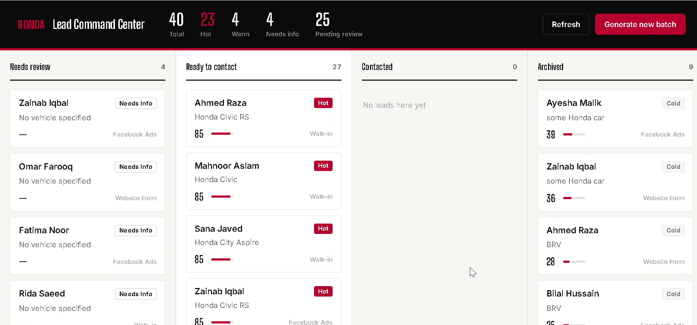
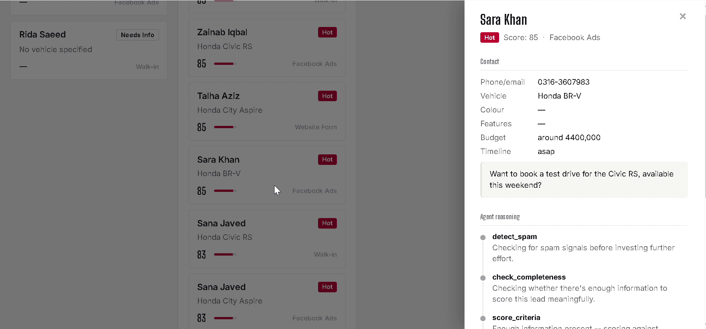
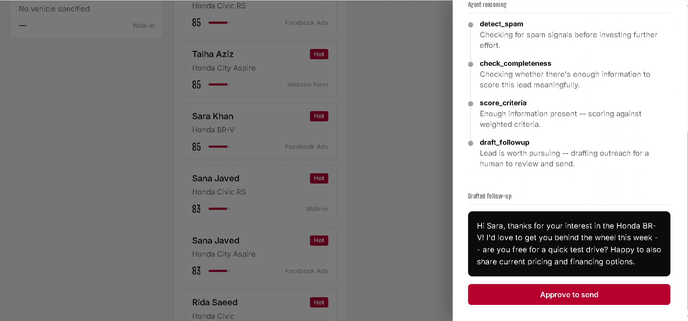
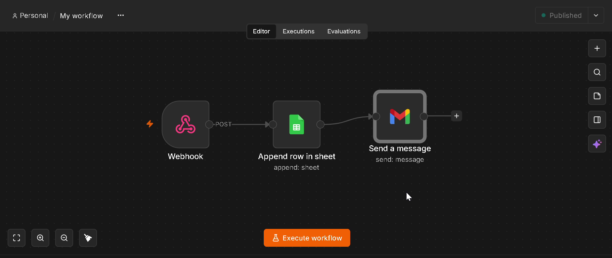

# AI Lead Automation — Lead Command Center

An agentic pipeline that scores every incoming car-sales lead, sorts it into Hot / Warm / Cold / Needs Info, and drafts a follow-up message. **A person approves every message before anything is sent.**

Built for the sales team at Honda Atlas Cars Pakistan.



---

## Table of contents

- [The problem](#the-problem)
- [What it does](#what-it-does)
- [How the agent works](#how-the-agent-works)
- [Screenshots](#screenshots)
- [Automation with n8n](#automation-with-n8n)
- [Tech stack](#tech-stack)
- [Getting started](#getting-started)
- [Current status](#current-status)
- [Limitations and next steps](#limitations-and-next-steps)

---

## The problem

Leads come in from several places: Facebook Ads, the website form and walk-ins. There was no automated way to tell which leads were worth chasing first, and every follow-up depended on someone reviewing each lead by hand.

## What it does

- **Scores every lead from 0 to 100** on timeline, budget, vehicle fit and buying intent.
- **Classifies each lead** as Hot, Warm, Cold, Needs Info or Spam.
- **Drafts a personalised follow-up** for Hot and Warm leads.
- **Shows its reasoning.** Every lead shows which steps the agent took and why.
- **Keeps a human in control.** Nothing is sent until someone clicks *Approve to send*.
- **Takes new leads through a web form** as well as generated sample batches.
- **Tracks the pipeline** on a Kanban board: Needs Review → Ready to Contact → Contacted → Archived.
- **Automates the next step.** An approved lead triggers an n8n workflow that logs it to Google Sheets and sends the follow-up email.

## How the agent works

The agent uses tool-calling. The LLM decides which tool to run next, step by step, instead of following a fixed script.

```
  New lead
     │
     ▼
┌──────────────┐   spam?  ──►  Archived (Spam)
│ detect_spam  │
└──────┬───────┘
       ▼
┌────────────────────┐   missing info?  ──►  Needs Info
│ check_completeness │
└──────┬─────────────┘
       ▼
┌────────────────┐
│ score_criteria │   weighted 0–100 → Hot / Warm / Cold
└──────┬─────────┘
       ▼
┌────────────────┐
│ draft_followup │   Hot / Warm only
└──────┬─────────┘
       ▼
  Human review  ──  Approve to send  ──►  n8n  ──►  Google Sheets + email
```

| Tool | What it does |
|---|---|
| `detect_spam` | Filters obvious spam before any more effort is spent on it |
| `check_completeness` | Checks there's enough information (vehicle, budget, timeline) to score the lead meaningfully |
| `score_criteria` | Scores the lead against weighted criteria and assigns a class |
| `draft_followup` | Writes a short, personalised message for a salesperson to review |

## Screenshots

**Lead details:** contact info, vehicle, budget, timeline and the customer's original message.



**Agent reasoning and approval:** each step the agent took, the drafted follow-up, and the approval button.



## Automation with n8n

When a Hot or Warm lead is approved, the backend calls an n8n webhook:



1. **Webhook** receives the approved lead
2. **Google Sheets** appends it to the lead log
3. **Gmail** sends the follow-up email

The workflow is triggered by the backend through the `N8N_WEBHOOK_URL` setting.

## Tech stack

| Layer | Tools |
|---|---|
| Backend | Python, FastAPI |
| Database | SQLite |
| AI agent | Tool-calling agent in plain Python, no agent framework. LLM calls go to Grok, Gemini or Claude (whichever key is set) over plain HTTP, with no SDK |
| Frontend | HTML, CSS, JavaScript |
| Automation | n8n (webhook → Google Sheets → Gmail) |

## Project structure

```
ai-lead-automation/
├── backend/
│   └── app/
│       ├── main.py        # FastAPI app and API routes
│       ├── agent.py       # tool-calling agent loop (Grok)
│       ├── tools.py       # detect_spam, check_completeness, score_criteria, draft_followup
│       ├── database.py    # SQLite storage for leads
│       ├── models.py      # data models
│       └── data_gen.py    # generates synthetic sample leads
├── frontend/
│   ├── index.html         # Lead Command Center dashboard (Kanban)
│   └── lead_form.html     # lead intake form
├── n8n/
│   └── workflow.json      # webhook → Google Sheets → Gmail
├── docs/screenshots/
├── requirements.txt
└── .env.example
```

## Getting started

### Prerequisites
- Python 3.10+
- An API key for Grok, Gemini or Claude (optional, see below)
- n8n (optional, only for the Sheets and email automation)

### Setup

```bash
python -m venv .venv
# Windows
.venv\Scripts\activate
# macOS / Linux
source .venv/bin/activate

pip install -r requirements.txt
```

Set your keys as environment variables. `.env.example` lists every variable the app reads.

```powershell
# Windows PowerShell
$env:GROK_API_KEY = "your_key_here"
$env:N8N_WEBHOOK_URL = "http://localhost:5678/webhook/your-id"   # optional
```

```bash
# macOS / Linux
export GROK_API_KEY="your_key_here"
```

If no LLM key is set, the app still runs, but the LLM-powered steps are skipped.

Start the backend:

```bash
cd backend
uvicorn app.main:app --reload
```

Then open `frontend/index.html` in your browser and click **Generate new batch** to create a set of sample leads. New leads can also be submitted through `frontend/lead_form.html`.

## Current status

| Feature | Status |
|---|---|
| Lead scoring and classification agent | ✅ Live |
| Kanban dashboard | ✅ Live |
| Human approval before outreach | ✅ Live |
| n8n logging to Google Sheets | ✅ Live |
| Automated follow-up email via Gmail | 🟡 Built, final authorisation pending |

## Limitations and next steps

- **Synthetic data.** Real lead data and Honda's lead criteria weren't available, so the sample leads and scoring weights are placeholders. Plugging in the real criteria is the next step.
- **Single agent.** The plan is to move to a multi-agent setup with LangGraph (separate agents for intake, scoring and follow-up).
- **Planned:** pulling leads directly from Facebook Ads and the website instead of generating them, plus a hosted deployment.
